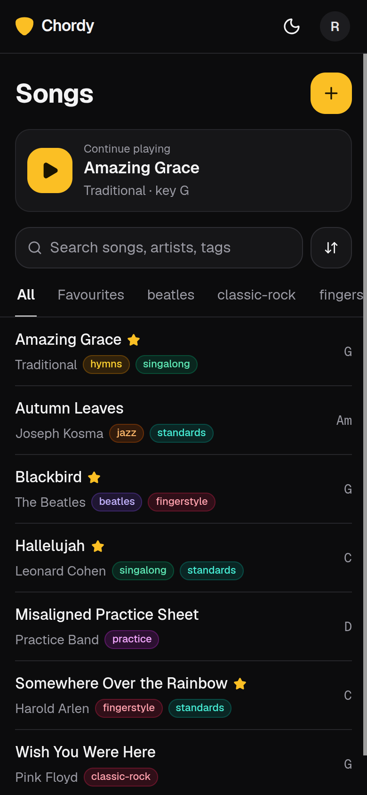
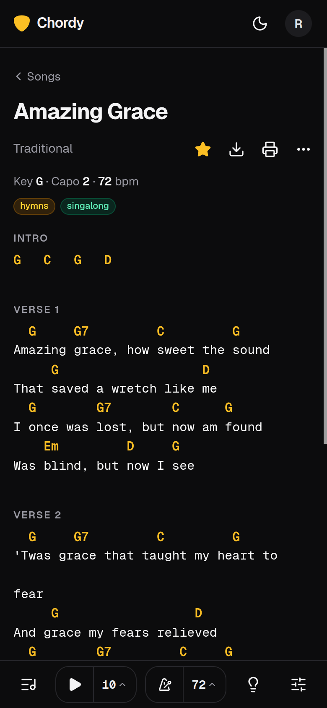
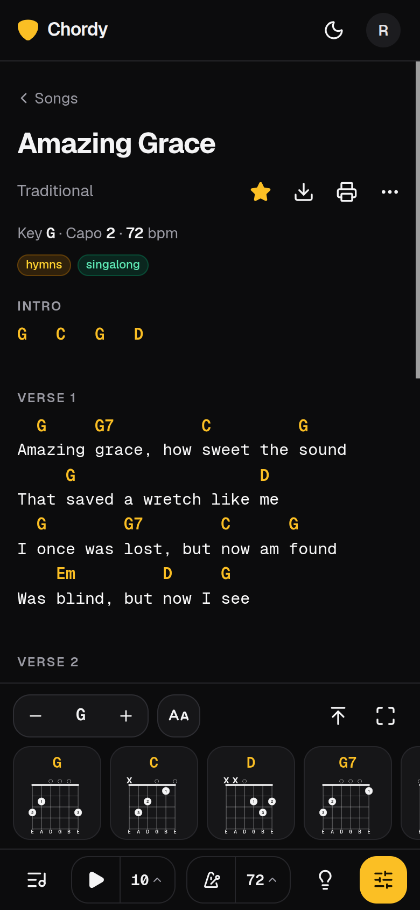
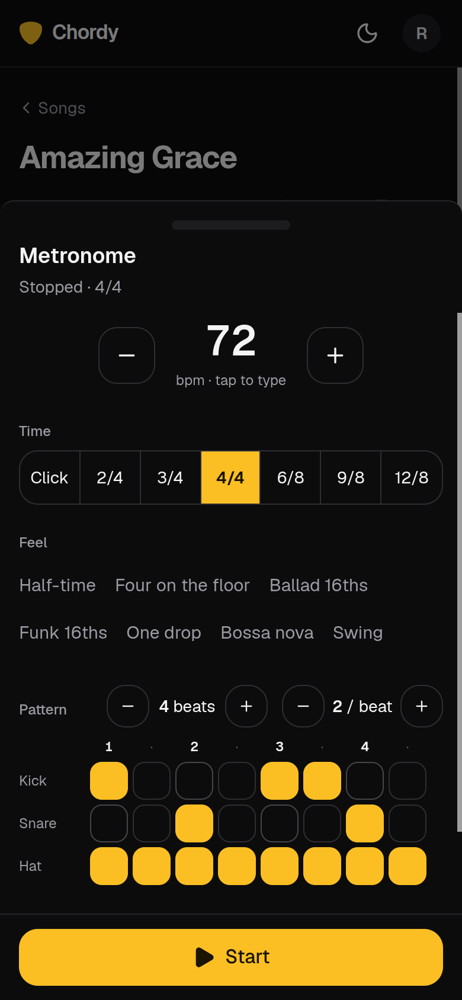

# Chordy

Chordy is a songbook for guitarists that you run on your own server. Keep your chord sheets in one
place, change their key in one tap, see how every chord is played, and let the page scroll while
both hands are on the guitar. It works best on a phone, and you can install it like an app.

<p align="center">
  
  
  
  
</p>

Everything runs in one container and is stored in one file. Nothing is sent to anyone else.

**Contents:** [Set it up](#set-it-up) · [Use it](#use-it) · [Settings](#settings) ·
[Backups](#backups) · [Upgrading](#upgrading) · [Development](#development)

---

## Set it up

You need a computer that stays on (a home server, a Raspberry Pi, a small cloud machine) with
[Docker](https://docs.docker.com/get-docker/) installed.

1. **Make a folder and download two files into it.**

   ```bash
   mkdir chordy && cd chordy
   curl -O https://raw.githubusercontent.com/meceware/chordy/main/docker-compose.yml
   curl -o .env https://raw.githubusercontent.com/meceware/chordy/main/.env.example
   ```

2. **Fill in `.env`.** Open it in any text editor and set these two lines:

   - `AUTH_SECRET`: a long random string. Generate one with
     `openssl rand -base64 32` and paste it in.
   - `SITE_URL`: the address you will open Chordy at, with no slash at the end. For a first try
     on the same computer, `http://localhost:3000` is fine.

3. **Start it.**

   ```bash
   mkdir -p data && sudo chown 1000:1000 data   # the container runs as user 1000
   docker compose up -d
   ```

4. **Make your account.** Open your `SITE_URL` in a browser, tap **Sign in**, and enter your
   email address. Chordy sends a link and a six-digit code; either one signs you in.

   Until you set up email (step 6), nothing is actually sent. The email is printed to the log
   instead, so run `docker logs chordy` and copy the code from there.

5. **Close sign-up.** Now that your account exists, stop anyone else from making one. In `.env`,
   set `DISABLE_SIGNUP=true`, then apply it:

   ```bash
   docker compose up -d
   ```

   You can still sign in as usual. Anyone else who tries gets no email at all.

6. **Set up email (optional, but needed to sign in from a new device without the log).** Fill in
   the `EMAIL_SERVER_*` and `EMAIL_FROM` lines in `.env` with your mail provider's SMTP details,
   then run `docker compose up -d` again.

7. **Reach it from your phone (optional).** The container only listens on the computer it runs
   on (`127.0.0.1`), so nothing else can reach it directly. To use it elsewhere, put a reverse
   proxy or tunnel on that same computer (Caddy, nginx, or Cloudflare Tunnel) and point
   `SITE_URL` at its public address. Before you do, make sure step 5 is done. For a second lock,
   put an access gate in front as well: a VPN, Cloudflare Access, or your proxy's own login.

The home page is public: signed out, it shows what Chordy is, a sign-in button, and an example
sheet. It never reads your songs. Every other page needs you to be signed in.

---

## Use it

### Add a song

1. On the **Songs** page, tap **+**.
2. Paste a chord sheet from anywhere, or tap **Paste**. Plain chords-over-lyrics and ChordPro both
   work.
3. Tap **Continue**. Chordy shows the sheet in the editor with the title, artist and key filled in
   where it could find them. Use **Preview** to see how it will look.
4. Tap **Create song**. From then on, every edit saves itself as you type; there is no save
   button.

A sheet is written the way you find them online, chords on one line and words on the next:

```text
[Verse 1]
  G     G7         C         G
Amazing grace, how sweet the sound
     G                  D
That saved a wretch like me
```

- A line in brackets, such as `[Verse]` or `[Chorus]`, becomes a heading.
- A line of chords with no words under it (an intro, a riff) keeps its spacing.
- Tab lines (`e|---0---|`) are kept as they are.
- ChordPro (`[G]Amazing [C]grace`) is converted when you paste it. Check the spacing before you
  create the song; this is the only step that changes it.
- Chords that Chordy can't read are counted in the editor, so typos stand out.

### Find a song

- **Search** finds songs by title, artist or tag, even with a typo.
- The coloured chips under the search box show **All**, your **Favourites**, or one tag at a
  time. Tap a chip again to clear it.
- The sort button orders the list by **Recently opened** (the default), **Title**, **Artist** or
  **Recently added**. This browser remembers your choice.
- **Continue playing**, at the top, opens the song you had open last.

### Get a song ready

Open a song. The card at the top holds everything you set before you start:

- **Key:** **−** and **+** move every chord down or up. Tap the key to go back to the original.
  The song remembers the key you leave it in.
- **Metronome:** shows the beat and tempo, such as `4/4 · 90`. Tap it to choose from a plain click
  to bossa nova and swing, set the tempo, or paint your own beat on the grid.
- **Chords:** **Hide** shows only the words.
- **Text size:** **−** and **+**.
- **Listen** opens the recording, if the song has a link. **Favourite** stars it. **Edit** opens
  the editor. **⋯** has **Download as Markdown**, **Print** and **Delete song**.

Below the card, **Tutorial** (when the song has a video) and **Chords** open when you tap them.
Folded, the Chords row still lists every chord in the song.

### Choose your chord shapes

Tap any chord, in the sheet or in the **Chords** card, to see how it is played.

1. Tap **Use** under the shape you play. Mark more than one if you switch between them.
2. From then on, tapping that chord shows only your shapes. **Show N others** brings back the rest.
3. If none fits, tap **Draw your own shape**, mark the frets, and save it.

Your choices are kept per song, so the same chord can have a different shape in each song.

### Play

The bar at the bottom stays on screen while the sheet scrolls:

| Button | What it does |
|---|---|
| ☰ **Songs** | The next song in title order, one tap away, and a searchable list of the rest |
| ⤒ **Top** | Glides back to the start of the sheet |
| ▶ **Scroll** | Tap the play icon to start or pause scrolling. Tap the number to change the speed (in pixels per second, 10 to start with). Each song remembers its speed. |
| 🎵 **Metronome** | Starts or stops the metronome in one tap |
| 💡 **Keep awake** | Stops the screen going dark, even when nothing is scrolling |
| ⛶ **Stage** | Fullscreen with only the sheet. Tap it again, or press Escape, to leave. |

With a keyboard attached:

| Key | Action |
|---|---|
| `Space` | Start or pause scrolling |
| `[` / `]` | Scroll slower / faster |
| `+` / `-` | Change the key up / down |
| `P` | Start or stop the metronome |
| `W` | Keep the screen on |
| `F` | Stage mode |

### Install it as an app

On a phone, open Chordy in the browser and choose **Add to Home Screen** (Safari: the Share
button; Chrome: the ⋮ menu). It then opens full screen, like any other app. On an iPhone, where
Safari never offers this by itself, Chordy shows the steps once.

---

## Settings

All settings live in `.env`. After changing one, run `docker compose up -d` to apply it.

| Setting | Needed? | What it does |
|---|---|---|
| `AUTH_SECRET` | yes | A long random string that protects sign-ins. Changing it signs everyone out. |
| `SITE_URL` | yes | The address you open Chordy at, with no slash at the end. Sign-in links use it. |
| `DISABLE_SIGNUP` | recommended | `true`: only accounts that already exist can sign in. `false` or missing: anyone who can reach Chordy can make an account. |
| `DATABASE_PATH` | no | Where songs are stored. Defaults to `data/chordy.db` in the folder from step 1. |
| `EMAIL_SERVER_HOST` | no | Your mail provider's SMTP server. Without it, sign-in emails go to the log. |
| `EMAIL_SERVER_PORT` | no | `587` by default. Use `465` if your provider says "SSL" or "implicit TLS". |
| `EMAIL_SERVER_USER`, `EMAIL_SERVER_PASSWORD` | no | Your SMTP login. Leave both empty for a relay that recognises your server by its address. |
| `EMAIL_FROM` | no | The address emails come from. Your provider must allow sending as it. |
| `UMAMI_SCRIPT_URL`, `UMAMI_WEBSITE_ID` | no | Count visits with your own [Umami](https://umami.is). The script address is your Umami's tracker (e.g. `https://stats.example.com/script.js`), or a path on Chordy's own address that your proxy forwards to Umami. The ID is the Website ID Umami shows for this site. Both must be set; visits are counted only on `SITE_URL`'s address. |

---

## Backups

Your songs are in one file, `data/chordy.db`. Don't copy it while Chordy is running: the newest
changes may still be in a side file, and the copy would quietly miss them. Use the backup command
instead:

```bash
docker exec chordy node scripts/backup.js
```

It writes `data/backups/chordy-<date and time>.db` and keeps the 14 most recent. To run it every
night at 3am, add this line with `crontab -e`:

```text
0 3 * * * docker exec chordy node scripts/backup.js
```

**To restore a backup:**

1. `docker compose down`
2. Replace `data/chordy.db` with the backup file, renamed to `chordy.db`.
3. Delete `data/chordy.db-wal` and `data/chordy.db-shm` if they exist.
4. `docker compose up -d`

Try a restore once before you need one.

---

## Upgrading

```bash
docker compose pull
docker compose up -d
```

Changes to the database are applied automatically on start. Two things to check if your `.env` is
from an older version:

- **`ALLOWED_EMAILS` is gone.** It is ignored now. Replace it with `DISABLE_SIGNUP=true`, or sign-up
  will be open.
- **The database file is `chordy.db`.** Older example files called it `chords.db`. If your songs
  are in `data/chords.db`, stop the container and rename it, plus any `chords.db-wal` and
  `chords.db-shm` files beside it, to `chordy.db`. Chordy warns on start if it finds the old name.

---

## Development

You need Node 24 (`nvm use` picks it up from `.nvmrc`).

```bash
npm ci
cp .env.example .env     # set AUTH_SECRET
npm run migrate
npm run dev              # http://127.0.0.1:3000, this computer only
```

Sign in with any address; sign-in emails print to the terminal. To try it with example songs,
sign in once, then run `npm run seed -- you@example.com`.

| Command | Does |
|---|---|
| `npm run dev` | Development server |
| `npm test` | Unit tests |
| `npm run lint` | Code checks (ESLint) |
| `npm run build` | Production build |
| `npm run migrate` | Applies `migrations/*.sql` (the container does this on start) |
| `npm run seed -- you@example.com` | Adds example songs to that account |
| `npm run claim -- you@example.com` | Moves songs seeded before you signed in onto your account |
| `npm run backup` | The backup above |

Where things are:

```text
src/app/            pages and server actions (Next.js App Router)
src/components/     the interface: song card, sheet, play bar, dialogs, editor; ui/ holds primitives
src/lib/sheet/      reading, transposing and exporting sheets
src/lib/chords/     chord names, shapes, and your own drawn shapes
src/lib/            database, sign-in, metronome, shared hooks
migrations/         database schema, applied in order
scripts/            migrate, seed, claim, backup, icons, container start-up
```
